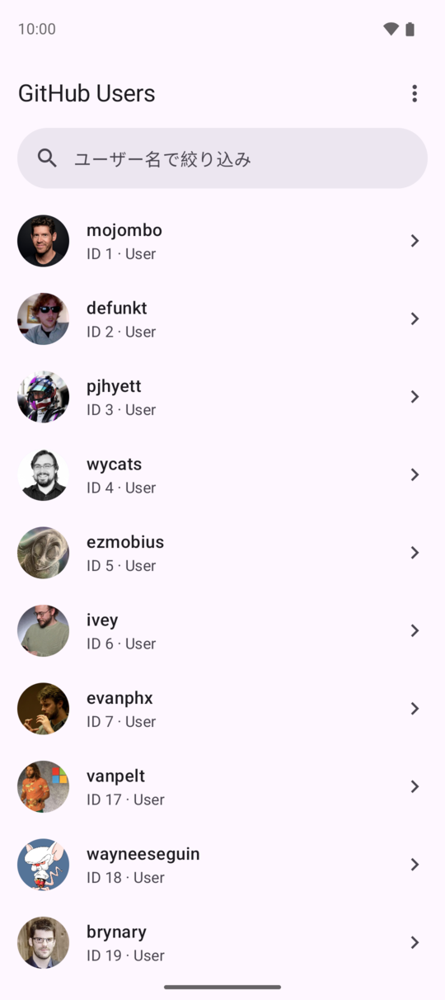
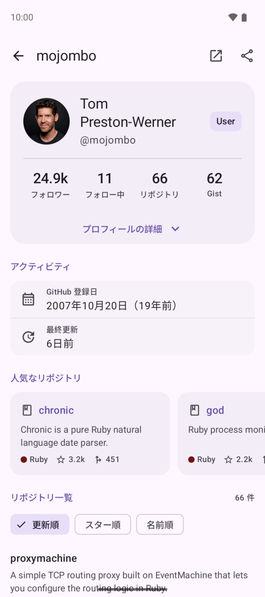
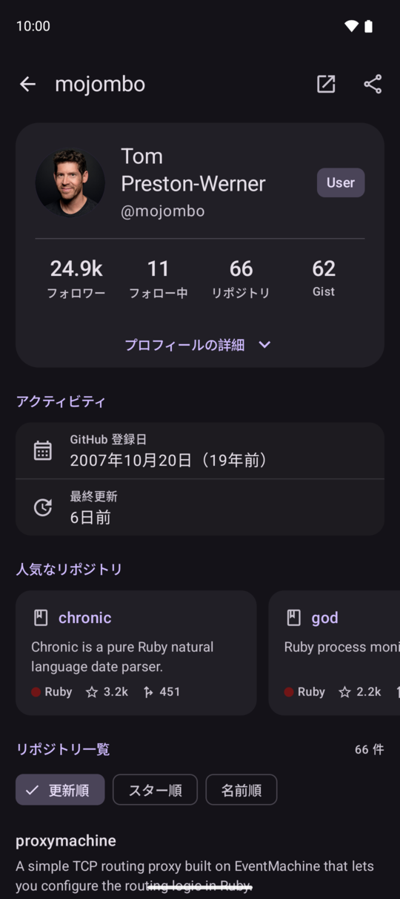
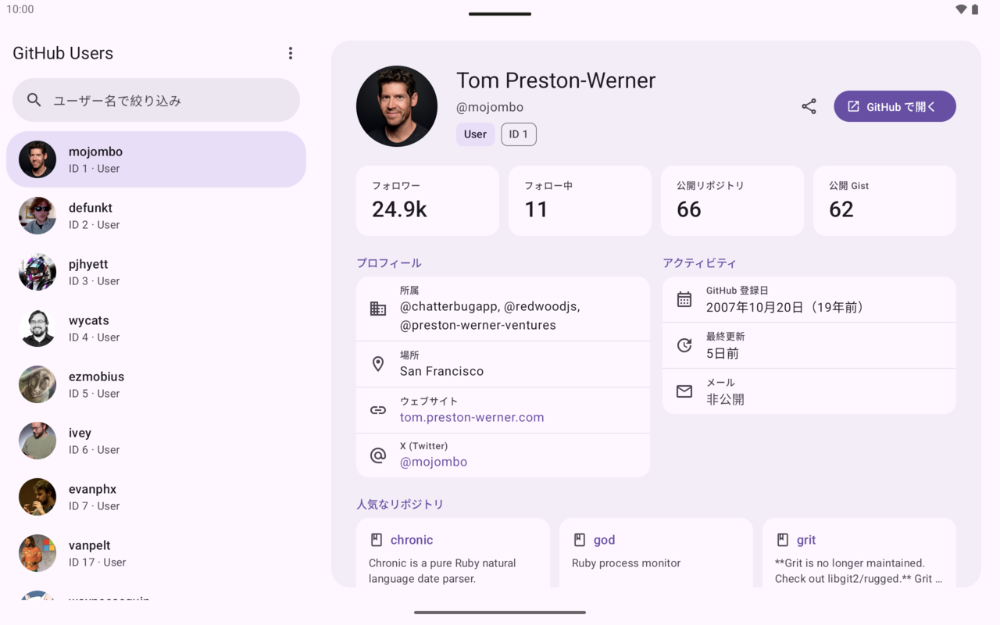
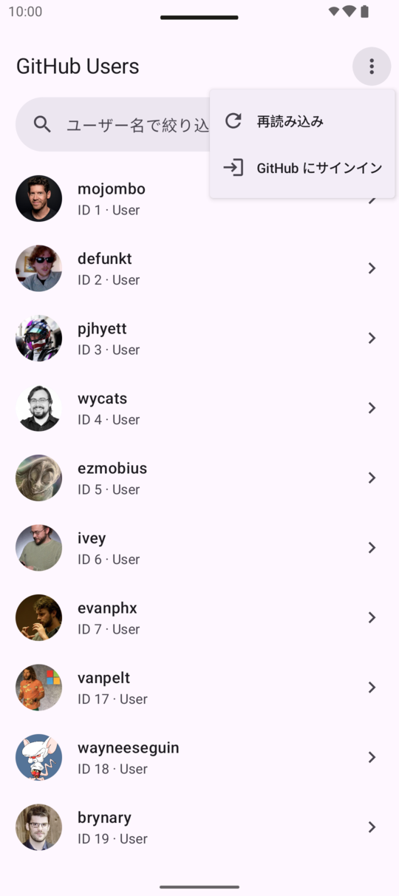
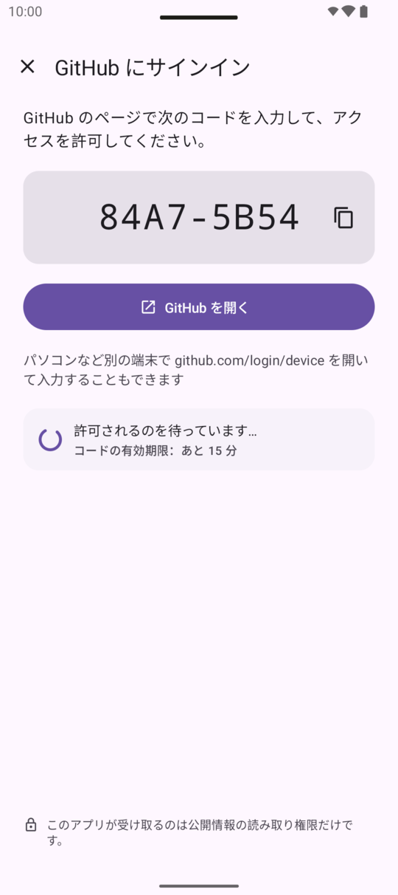
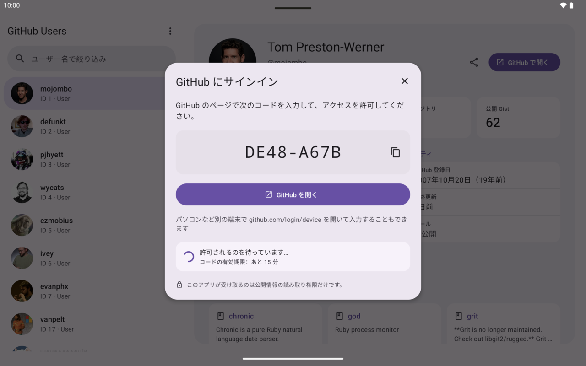

# GitHub Users

GitHub の User API を使って、ユーザーの一覧と詳細を表示する Android アプリです。
Kotlin・Jetpack Compose・Material 3 で作り、スマホでは1ペイン、タブレットではリストと詳細の2ペインで表示します。

<p>
  
  
  
</p>



## 主な機能

### ユーザー一覧

- `GET /users` で取得したユーザーを、アバター・ログイン名・ID・種類とともに一覧で表示します
- 末尾に近づくと、最後に読み込んだユーザーの ID を `since` に渡して続きを読み込みます
- 読み込み済みの一覧を、ログイン名で絞り込めます（API に検索機能がないため、手元で絞り込みます）
- 引っ張って更新できます

### ユーザー詳細

- プロフィール（名前、自己紹介、フォロワー数などの統計、所属・場所・ウェブサイト・メール・X）
- アクティビティ（GitHub に登録した日、最終更新）
- 人気なリポジトリ（スター数の多い上位3件）
- リポジトリ一覧（更新順・スター順・名前順で並び替え、「さらに表示」で続きを表示）
- GitHub のページを Custom Tabs で開く、プロフィールの URL を共有する

### 画面の大きさとテーマ

- スマホは一覧 → 詳細の1ペイン遷移、タブレットと横向きのスマホは左に一覧、右に詳細の2ペイン
- 詳細ペインの幅が十分にあれば、統計をカードで並べ、プロフィールとアクティビティを2列で表示するタブレット用のレイアウトにします
- ライト／ダークの両方に対応しています

### 状態の表示

読み込み中のスケルトン、初回の読み込みの失敗、追加読み込みの失敗、レート制限のそれぞれに専用の表示があります。
レート制限のときは解除される時刻を表示し、未ログインならサインインを勧めます。

### GitHub へのサインイン（任意）

<p>
  
  
</p>



認証なしの GitHub API は 1 時間に 60 回までしか呼べません。サインインすると、上限が 1 時間 5,000 回に増えます。
サインインしなくても、すべての機能を使えます。

- GitHub App の [Device Flow](https://docs.github.com/en/apps/creating-github-apps/authenticating-with-a-github-app/generating-a-user-access-token-for-a-github-app#using-the-device-flow-to-generate-a-user-access-token) を使います。アプリが表示するコードを、GitHub のページで入力して許可します
  - アプリはパスワードを扱わず、`client_secret` も持ちません
  - 「GitHub を開く」を押すと、コードをコピーしてから GitHub のページを開きます。パソコンなど別の端末で入力することもできます
- 要求する権限はありません（公開情報の読み取りだけ）
- トークンは DataStore と Tink で暗号化して保存します。暗号鍵は Android Keystore に置き、バックアップの対象から外しています
- トークンは 8 時間で切れるので、期限の前に自動で更新します。GitHub 側で許可が取り消されたときは、自動でサインアウトして読み込みを続けます
- スマホでは全画面、タブレットではダイアログで表示します

## 技術スタック

| 分野 | 使っているもの |
|---|---|
| 言語・UI | Kotlin、Jetpack Compose、Material 3、material3-adaptive |
| 画面遷移 | Navigation 3（`NavDisplay`、`ListDetailSceneStrategy`、`DialogSceneStrategy`） |
| DI | Hilt（ViewModel の引数は assisted injection） |
| 通信 | Retrofit、OkHttp（HTTP キャッシュ）、kotlinx.serialization |
| 画像 | Coil 3 |
| 保存 | DataStore、Tink（`datastore-tink`） |
| ブラウザ | androidx.browser（Custom Tabs） |
| テスト | JUnit 4、kotlinx-coroutines-test、MockWebServer |
| ビルド | AGP 9（組み込みの Kotlin）、Gradle のバージョンカタログ、`build-logic` の convention plugin |

- `minSdk` 26、`compileSdk` / `targetSdk` 37
- 依存ライブラリは、Google・JetBrains・Square などの組織が管理しているものだけを使っています

## アーキテクチャ

[Now in Android](https://github.com/android/nowinandroid) を参考にしたマルチモジュール構成です。

```
app ─▶ feature:* ─▶ core:data ─▶ core:network ─▶ core:model
            │              └──────▶ core:datastore
            └──────▶ core:ui ─▶ core:designsystem
```

| モジュール | 役割 |
|---|---|
| `:app` | 画面の組み立て（Navigation 3 のバックスタック）、Snackbar、Hilt の起点 |
| `:feature:userlist` / `:feature:userdetail` / `:feature:signin` | 画面ごとの UI と ViewModel |
| `:core:data` | Repository（API の呼び出し、エラーの変換、サインインの管理） |
| `:core:network` | Retrofit・OkHttp の設定、認証ヘッダーの付与、レート制限ヘッダーの読み取り |
| `:core:datastore` | 暗号化したサインイン情報の保存 |
| `:core:model` | データ型とエラーの型（Android に依存しない） |
| `:core:designsystem` / `:core:ui` | テーマと共通の UI 部品 |
| `:core:testing` | テスト用の偽の Repository とデータ |

主な設計判断：

- **キャッシュ**：OkHttp の HTTP キャッシュだけを使います。GitHub は `ETag` を返し、304 の応答はレート制限の回数に数えられないので、回数を節約できます
- **追加読み込み**：Paging 3 を使わずに自分で書いています。手元での絞り込みと合わせやすく、テストもしやすいためです
- **人気なリポジトリとスター順**：`/users/{login}/repos` はスター順に並べられないので、Search API を使います
- **2ペインでの戻る操作**：初期値の動作では、詳細を表示中に戻るとアプリが閉じてしまうため、詳細を閉じて未選択に戻すようにしています
- **トークンの更新**：リフレッシュトークンは使うたびに変わるので、同時に複数の通信が 401 になっても、更新は1回にまとめています

詳しくは [docs/ARCHITECTURE.md](docs/ARCHITECTURE.md) を、UI の仕様は [docs/design/DESIGN.md](docs/design/DESIGN.md) を参照してください。

## ビルドと実行

AGP 9.4 に対応した Android Studio でプロジェクトを開くか、次のコマンドを使います（JDK 17 以上）。

```bash
./gradlew :app:assembleDebug        # デバッグ版の APK を作る
./gradlew testDebugUnitTest         # すべての単体テスト
./gradlew :app:assembleRelease      # R8 で縮小した release 版（署名なし）
```

### GitHub App の Client ID

サインインには GitHub App の Client ID を使います。Client ID は APK に含まれる公開の値なので、[gradle.properties](gradle.properties) にコミットしています。
自分の GitHub App で試すときは、`local.properties` に書くと上書きできます。

```properties
githubusers.oauthClientId=Iv23li...
```

GitHub App は、「Enable Device Flow」をオンにし、権限は何も付けずに登録します。Client ID が空のときは、サインインの入口を表示しません。

## テスト

単体テストは 73 件です。

| 対象 | 主な内容 |
|---|---|
| ViewModel（一覧・詳細・サインイン） | 読み込み・追加読み込み・絞り込み・再試行、レート制限の後にサインインしたときの再読み込み、Device Flow の状態の切り替わり、回転やプロセスの終了の後の再開 |
| Repository | MockWebServer を使った API の呼び出しとエラーの変換、Device Flow の問い合わせの間隔（`slow_down`、期限切れ、拒否、一時的な障害） |
| トークンの管理 | 期限前の更新、401 のときの更新とサインアウト、同時に 401 が返ったときに更新が1回だけ行われること |
| 通信 | 認証ヘッダーを `api.github.com` だけに付けること、401 のときのやり直しが1回までであること |
| 保存 | 暗号化して読み戻せること、別の鍵や別のファイルの暗号文を壊れたデータとして扱うこと |
| 表示用の処理 | 数値の短縮表示（`24.1k` など）、相対時間 |

## 今後の改善

- Compose の UI テストとスクリーンショットテスト
- Room によるオフライン対応
- GitHub の「草」（GraphQL API はサインインが必要）
- 起動時に絞り込み欄にフォーカスが当たり、キーボードが出ることがある（ハードウェアキーボードのある端末やエミュレーター）

## ドキュメント

- [docs/ARCHITECTURE.md](docs/ARCHITECTURE.md)：モジュール構成と設計判断
- [docs/design/DESIGN.md](docs/design/DESIGN.md)：UI の仕様（`docs/design/mockups/` はモックアップのソース）
- [CLAUDE.md](CLAUDE.md)：開発のルール（AI ツール向けの説明を兼ねる）
